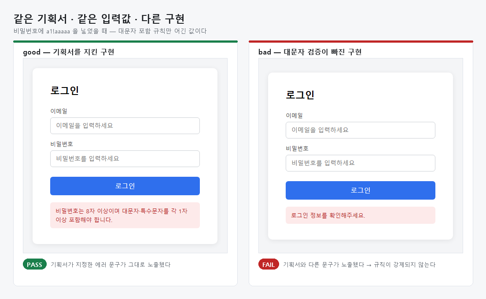
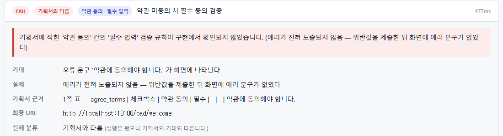
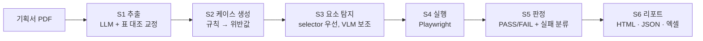
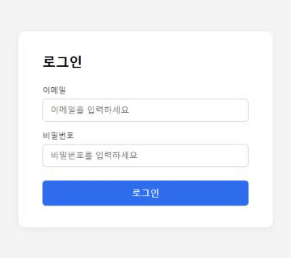

# Prova

**화면기획서 PDF를 읽어 테스트 케이스를 스스로 만들고, 실제 브라우저로 실행해 기획과 구현이 어긋난 곳을 찾아내는 웹 GUI QA 에이전트.**

팀 소인배 · 2026 하반기 WE-Meet · 의뢰: ㈜WITCHES



## 무엇을 하는가

QA 담당자는 화면기획서를 읽고 손으로 테스트 케이스를 만들어 하나씩 눌러 본다. Prova 는 그 일을 대신한다.

1. 기획서 PDF 에서 화면·요소·검증 규칙·에러 문구를 뽑는다 (로컬 LLM, Qwen3.5-4B)
2. 규칙마다 그것을 어기는 입력값을 만들어 테스트 케이스로 편다 (코드, LLM 없음)
3. Playwright 로 실제 사이트를 조작하고 스텝마다 스크린샷·DOM 을 남긴다
4. 기획서가 말한 결과와 화면을 대조해 PASS/FAIL 을 정하고, **실패가 구현 결함인지 도구·환경 문제인지 나눠서** 리포트(HTML·엑셀)로 낸다

리포트의 실패 카드는 무엇을 넣었는지, 기획서가 무엇을 기대했는지, 그 기대가 기획서 몇 쪽 어느 줄에 적혀 있는지를 함께 보여 준다.



## 결과

| 무엇을 쟀나 | 결과 |
|---|---|
| PASS/FAIL 판단 정확도 — 결함을 심은 웹앱, 정답 라벨 1,119건 | **98.5%** · 거짓 결함 0 · 놓친 결함 0 |
| 실제 회사 기획서 1건과 그 사이트 — 기획서 추출 | 처음 0% → **82.2%** (37/45) |
| 같은 사이트 — 기획서와 구현의 실제 차이 탐지 | **11건 중 8건 · 오탐 0** |
| 변이 시험 — 외부 사이트 기획서 5개에 정답 있는 차이 26개를 심음 | **24개 탐지 (92%)** |
| 요소 탐지 — 1차 경로(selector) | **96.8%** · 없는 요소를 있다고 한 것 0 · 평균 6.8ms |
| 요소 탐지 — 2차 경로(화면 이미지, Qwen3.5-4B), 외부 화면 40항목 | 적중 90.0% · IoU 기준 85.0% (목표 90% 미달) |
| 로컬 4B 모델 vs Claude Haiku 5.5·Opus 5.5 — 기획서 추출 골든 105항목 | 셋 다 **105/105** |
| 리포트 완결성 — 실패 케이스 1,525건 | 실행 로그·입력·기대·실제·원인 **100%** |

숫자마다 한계가 있다. 실물 기획서는 표본이 한 건이고, 결함을 심은 웹앱은 도구를 고치며 함께 만든 것이다.
자세한 표와 한계는 [docs/results.md](docs/results.md), 측정 원본은 [docs/measurements/](docs/measurements/).

## 구조



- **LLM 은 기획서를 읽는 데만 쓴다.** 케이스 생성과 판정은 코드다 — 같은 입력에 같은 판정이 나와야 QA 도구다.
- **모델이 읽은 것을 그대로 믿지 않는다.** 표에서 직접 읽은 사실로 교정하고, 사람이 실행 전에 고칠 수 있다.
- **못 찾은 것을 결함이라고 하지 않는다.** 요소를 못 찾았거나 페이지가 안 열린 것은 '실행 문제' 로 따로 센다.
- **요소는 라벨·역할로 먼저 찾는다.** 화면 이미지로 찾는 모델은 그것이 실패한 자리에서만 쓴다 — 측정해 보니 더 느리고 없는 것을 지어냈다.

Python 3.11 · Pydantic · Playwright · vLLM(OpenAI 호환) · FastAPI · LangGraph · pytest (테스트 1,801개).
폴더별 설명은 [docs/architecture.md](docs/architecture.md).

## 빨리 돌려보기

GPU 없이 돈다. `--backend mock` 은 저장소의 예시 기획서 전용 연습 모드다.

```powershell
uv sync --extra dev
uv run playwright install chromium

# 테스트 대상 웹앱 (별 터미널) — 기획서를 지킨 구현 /good 과 검증을 빠뜨린 구현 /bad
uv run uvicorn sut.app:app --port 8100 --reload --reload-dir sut

uv run prova run --pdf fixtures/specs/signup_spec.pdf --url http://localhost:8100/good --backend mock
uv run prova run --pdf fixtures/specs/signup_spec.pdf --url http://localhost:8100/bad  --backend mock
start runs/<run-id>/report.html

uv run prova serve      # 웹 UI — http://127.0.0.1:7007
```

`/bad` 는 17개 중 4개가 FAIL 로 나온다 — 심어 둔 결함 4개 그대로다.
`--backend replay` 를 쓰면 실제 모델이 냈던 응답을 그대로 재생한다(`fixtures/replay-cache`).



개정판 비교, 쓰기 요청 막기(dry-run), 휴대폰 화면, 자연어로 범위 좁히기, 실모델 연결은 [docs/usage.md](docs/usage.md).

## 더 읽을 것

| 문서 | 무엇이 있나 |
|---|---|
| [docs/design-decisions.md](docs/design-decisions.md) | 명세서와 다르게 구현한 38군데와 각각의 이유 |
| [docs/lessons.md](docs/lessons.md) | 문서로 예측하지 못했고 코드를 돌려서 알게 된 것들 |
| [docs/results.md](docs/results.md) | 화면·변형별 결과 전체와 해석 |
| [docs/measurements/](docs/measurements/) | 측정 원본 — 위 표의 숫자가 나온 곳 |
| [docs/teaching/00-overview.md](docs/teaching/00-overview.md) | 단계별 설계를 순서대로 설명한 노트 |
| [docs/roadmap.md](docs/roadmap.md) | 아직 안 한 것 |
| [docs/README.md](docs/README.md) | 문서 전체 안내 |
