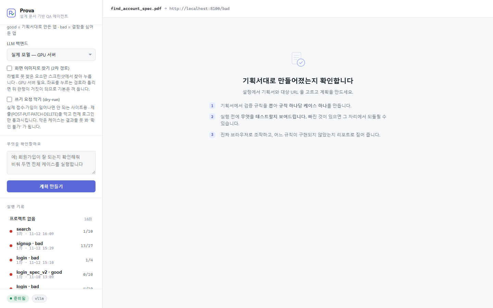
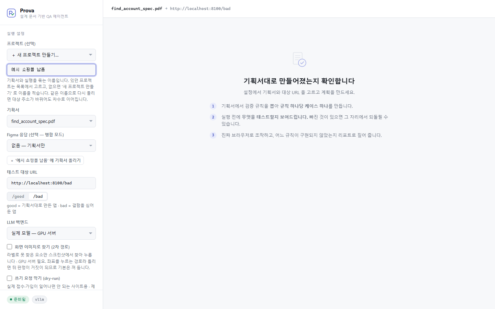
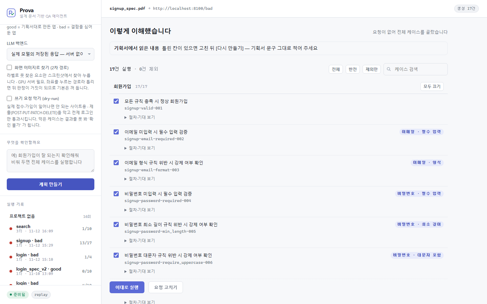
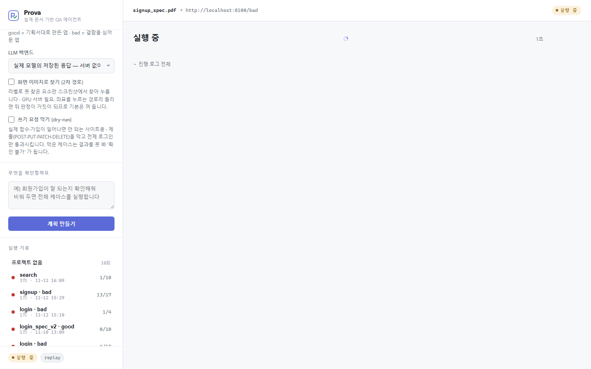
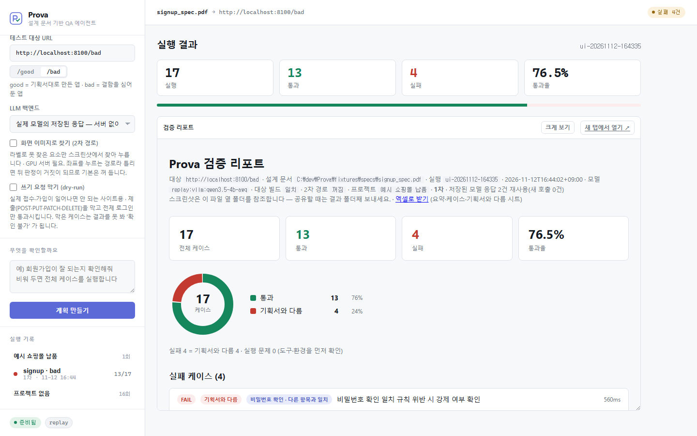
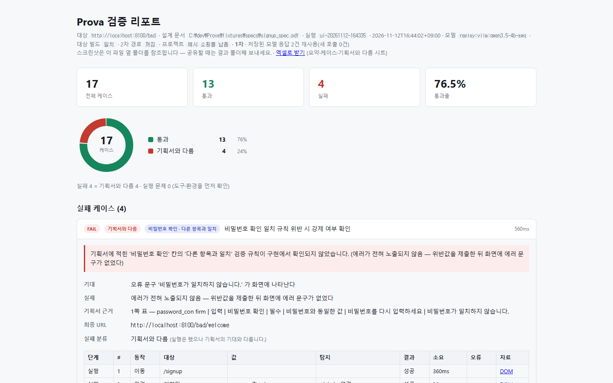
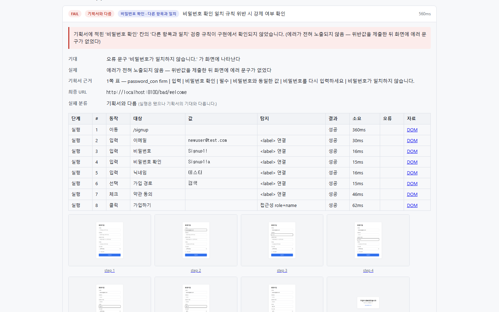
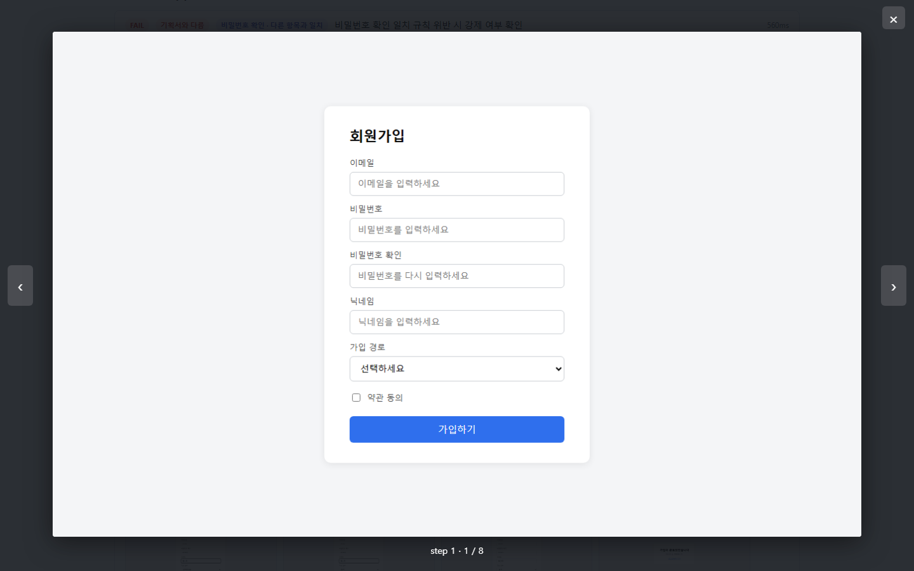

# 디자인 요청서 — Prova 웹 UI · 검증 리포트

> 2026-11-12 작성. 화면 캡처는 같은 날 찍었다(`screens/`, 1440×900, 예시 기획서와 저장된 모델 응답).
> 기능 개발은 일단락됐고, 지금 화면은 개발하면서 최소한으로만 입힌 상태다.

## 1. 무엇을 하는 도구인가

**기획서(PDF)를 읽고 실제 사이트를 직접 조작해서, 기획서와 다르게 만들어진 곳을 찾아 주는 도구다.**

- 쓰는 사람: 외주 개발 결과물을 검수하는 **기획자(PM/PL)**. 개발자가 아니다 — 코드 용어를 모른다고 보고 만든다.
- 쓰는 곳: 자기 PC 에서 띄워서 브라우저로 연다(회사 자료가 밖으로 나가지 않게 하려는 것).
- 쓰는 흐름: 기획서 고르기 → 무엇을 검사할지 확인 → 실행 → 리포트 읽기 → 고쳐 오면 다시 돌려 비교(1차·2차…).

## 2. 부탁하는 것

**웹 UI 와 검증 리포트의 겉모습**이다 — 색, 글꼴, 간격, 배치, 정보의 위계.

| 범위 안 | 범위 밖 |
|---|---|
| 웹 UI 한 화면(왼쪽 설정 + 오른쪽 작업 영역)의 네 상태 | 기능 추가·삭제 |
| 검증 리포트(한 장짜리 HTML) | 문구의 뜻을 바꾸는 것(다듬는 제안은 환영) |
| 밝은 화면 · 어두운 화면 | 로고·브랜드 작업(있으면 좋지만 필수 아님) |
| 좁은 화면에서 깨지지 않는 정도 | 엑셀 리포트, 테스트 대상 예시 사이트 |

배치를 바꾸는 제안(예: 설정을 위로 올리기, 리포트의 순서 바꾸기)은 자유롭게 해도 된다.
다만 4절의 "지켜야 하는 것"은 디자인이 아니라 도구의 안전장치라 그대로 두어야 한다.

## 3. 화면

웹 UI 는 화면이 하나다. 왼쪽에 설정과 실행 기록이 있고, 오른쪽이 상태에 따라 바뀐다.

### 3-1. 첫 화면



- 왼쪽 위부터: 프로젝트 → 기획서 → 테스트 대상 주소 → 모델 → 선택 사항 두 개 → 요청 문장 → **계획 만들기**.
- 아쉬운 점: 설정이 길어서 1440×900 에서도 **계획 만들기 버튼이 스크롤해야 보인다.** 체크박스 두 개의
  설명 글이 길고 빽빽하다. 처음 쓰는 사람이 꼭 정해야 하는 것(기획서·주소)과 가끔 쓰는 것이 같은 무게로 보인다.

새 프로젝트를 만들 때만 이름 칸이 나온다.



### 3-2. 계획 확인 — "이렇게 이해했습니다"



- 도구가 기획서에서 읽어 낸 검사 목록을 **실행 전에** 보여 주는 화면이다. 사람이 빼거나 고친 뒤 실행한다.
- 케이스마다: 체크박스 · 제목 · 식별자 · 어떤 항목의 어떤 규칙인지(오른쪽 꼬리표) · 절차/기대 펼치기.
- 아쉬운 점: 케이스가 많으면(17건) 한참 내려가야 한다. **이대로 실행** 버튼이 목록에 겹쳐 떠 있다.
  식별자(`signup-email-format-003`)는 기획자에게 필요 없을 수 있다 — 줄일지 의견을 달라.
- 전체 길이: [03-plan-full.png](screens/03-plan-full.png)
- 요청 문장으로 좁혔을 때(뺀 케이스가 흐리게 보인다): [11-plan-by-request.png](screens/11-plan-by-request.png)

### 3-3. 실행 중



- 아쉬운 점: **화면이 거의 비어 있다.** 지금 몇 번째 케이스를 돌리는지, 얼마나 남았는지가 한눈에 안 들어온다.
  실행은 짧으면 10초, 길면 몇 분이다.

### 3-4. 실행 결과



- 위에 숫자 네 칸(실행·통과·실패·통과율), 필요하면 알림 상자, 그 아래 리포트가 칸 안에 들어 있다.
- 아쉬운 점: **같은 숫자 네 칸이 위(웹 UI)와 아래(리포트 안)에 두 번 나온다.** 리포트가 작은 칸 안에서
  따로 스크롤된다('크게 보기' 를 눌러야 편하다 — [05-result-tall.png](screens/05-result-tall.png)).
- 고친 뒤 다시 돌린 2차 결과 — 직전과 비교한 상자가 붙는다: [09-second-round.png](screens/09-second-round.png)
- 실행 기록은 프로젝트별로 접힌다: [10-run-history.png](screens/10-run-history.png)

알림 상자는 종류가 여럿이다. 모두 "이 결과를 이렇게 읽으면 안 된다"를 말하는 안전장치다.

| 상황 | 캡처 |
|---|---|
| 요소를 못 찾은 케이스가 있다 | [12-notice-not-found.png](screens/12-notice-not-found.png) |
| 쓰기 요청을 막고 돌렸다 | [13-dry-run.png](screens/13-dry-run.png) |
| 실행을 시작하지 못했다(오류) | [14-error.png](screens/14-error.png) |

- 아쉬운 점: 같은 알림이 웹 UI 와 리포트 안에 **한 번씩 두 번** 보인다(12번 캡처). 정보·경고·오류의
  세기 차이가 약하다.

### 3-5. 검증 리포트

리포트는 **파일 하나로 따로 떨어져 나가는 문서**다. 기획자가 결과 폴더째 개발사에 보낸다.
웹 UI 안에서도 보이고, 파일만 열어도 똑같이 보여야 한다.



- 순서: 제목 · 실행 조건 한 줄 · 알림 상자들 · 숫자 네 칸 · 원형 차트 · 화면별 요약 · 실패 케이스 · 통과 케이스.
- 전체 길이: [06-report-full.png](screens/06-report-full.png)
- 아쉬운 점: 제목 아래 **실행 조건 줄이 빽빽해서 읽히지 않는다**(대상·기획서·실행 번호·시각·모델·차수…).
  '엑셀로 받기' 가 기본 파란 링크다. 알림 상자가 여러 개 쌓이면 정작 결과(숫자)가 아래로 밀린다.

실패 카드를 펼치면 이 도구의 핵심 정보가 나온다 — **기대 / 실제 / 기획서의 어느 줄인지 / 무엇을 넣었는지 / 화면 캡처.**



- 아쉬운 점: 단계 표가 넓고 개발자 용어(탐지, DOM)가 섞여 있다. 캡처가 작아서 눌러 봐야 보인다.
  기획자가 제일 먼저 봐야 하는 것은 맨 위 분홍 상자(왜 실패인가)와 '기획서 근거' 인데 표에 묻힌다.

캡처를 누르면 화면 위에 크게 뜬다(Esc·×·바깥 누르기로 닫고 ←→ 로 넘긴다). 모양은 임시다.



### 3-6. 어두운 화면 · 좁은 화면

| | 캡처 |
|---|---|
| 어두운 화면 | [첫 화면](screens/20-dark-home.png) · [계획](screens/21-dark-plan.png) · [결과](screens/22-dark-result.png) · [리포트](screens/23-dark-report.png) |
| 좁은 화면(390px) | [첫 화면](screens/30-narrow-home.png) · [리포트](screens/31-narrow-report.png) |

좁은 화면은 깨지지 않는 정도만 맞춰 두었다. 휴대폰으로 쓰는 도구는 아니다.

## 4. 지켜야 하는 것

디자인을 막으려는 것이 아니라, 이 도구가 틀린 인상을 주지 않게 하는 장치들이다.

1. **알림 상자는 숨기거나 접지 않는다.** "예시 응답으로 돌린 결과다", "일부만 실행했다", "쓰기 요청을 막았다",
   "화면 이미지로 찾기를 껐다" 같은 상자는 통과율을 잘못 읽지 않게 하는 것이다. 모양·위치는 바꿔도 되지만
   숫자보다 눈에 덜 띄면 안 된다.
2. **실패의 종류를 색으로 구분한다.** '기획서와 다름'(진짜 결함, 빨강) · '실행 문제'(도구·환경 쪽, 보라) ·
   '확인 불가'(결함도 통과도 아님)는 서로 다른 것으로 보여야 한다. 전부 빨강이면 기획자가 개발사에 잘못 따진다.
3. **색만으로 구분하지 않는다.** PASS/FAIL, 종류 꼬리표는 글자가 함께 있어야 한다(흑백 인쇄, 색각).
4. **리포트는 파일 하나로 완결된다.** 바깥에서 내려받는 글꼴·아이콘·그림을 쓸 수 없다(회사 내부망, 폴더째 전달).
   글꼴은 PC 에 깔린 것을 쓴다 — 지금은 Pretendard 가 있으면 쓰고 없으면 시스템 글꼴이다.
   아이콘은 글자나 직접 그린 SVG 만 된다.
5. **웹 UI 도 인터넷 없이 뜬다.** 같은 이유로 외부 글꼴·CDN 을 쓰지 않는다.
6. **웹 UI 와 리포트는 같은 색·글꼴을 쓴다.** 리포트가 웹 UI 안에 들어가므로 둘이 다르면 한 화면에 파랑이 두 가지가 된다.
7. **어두운 화면을 따로 그리지 않는다.** 색 이름(배경·글자·선·강조…)마다 밝은 값과 어두운 값을 한 쌍으로 정하면
   나머지는 자동으로 따라온다. 화면을 두 벌 그릴 필요는 없고, 색 표만 두 벌이면 된다.
8. **문구는 기획자의 말로 둔다.** '기획서와 다름', '이렇게 이해했습니다' 같은 말은 일부러 고른 것이다.
   더 쉬운 말이 있으면 제안해 달라.

## 5. 지금의 색·글꼴

한 파일(`src/prova/theme.py`)에 모여 있고, 값을 바꾸면 웹 UI 와 리포트가 함께 바뀐다.

| 쓰임 | 지금 값 |
|---|---|
| 강조(버튼·링크·선택) | 남색 계열 `#5b6ad6` (어두운 화면 `#8b98e8`) |
| 통과 | 초록 `#16875c` |
| 기획서와 다름 · 오류 | 빨강 `#c33a30` |
| 주의 | 호박색 `#96660c` |
| 실행 문제 | 보라 `#6a48ab` |
| 배경 · 선 · 글자 | 회색 14단계 (`#ffffff` ~ `#0e1116`) |
| 글꼴 | Pretendard → 시스템 글꼴, 숫자·주소·식별자는 고정폭(Cascadia Mono 등) |
| 간격 | 4 · 8 · 12 · 16px 단위 |

색을 통째로 바꿔도 된다. 다만 통과=초록, 결함=빨강의 뜻은 유지한다.

## 6. 받고 싶은 결과물

- **화면 시안**: 3절의 다섯 상태(첫 화면 · 계획 확인 · 실행 중 · 실행 결과 · 리포트)와 실패 카드, 알림 상자 세 종류.
  밝은 화면 기준으로 그리면 된다. 도구는 무엇이든 좋다(Figma 권장).
- **색 표**: 5절 표의 쓰임마다 밝은 값 · 어두운 값.
- **글꼴 크기 · 간격 규칙**: 제목 · 본문 · 작은 글씨 정도.
- 코드로 옮기는 것은 개발 담당이 한다. HTML·CSS 를 직접 줄 필요는 없다(주면 더 빠르다).

화면은 프레임워크 없이 HTML·CSS·자바스크립트로만 되어 있다. 복잡한 움직임이나 특수한 컴포넌트보다
**정보의 순서와 위계를 바로잡는 쪽**이 효과가 크다.

## 7. 직접 띄워 보기

캡처로 부족하면 직접 띄워 볼 수 있다. 모델 서버(GPU) 없이 된다.

```powershell
git clone https://github.com/KIMDONGWOOK-KR1/Prova.git
cd Prova
uv sync --extra dev
uv run playwright install chromium
uv run uvicorn sut.app:app --port 8100     # 터미널 1 — 테스트 대상 예시 사이트
uv run prova serve                         # 터미널 2 — http://127.0.0.1:7007
```

웹 UI 에서 **LLM 백엔드를 '실제 모델의 저장된 응답'** 으로 바꾸고, 기획서 `signup_spec.pdf` ·
주소 `http://localhost:8100/bad` 로 계획 만들기 → 이대로 실행을 누르면 3절의 화면이 그대로 나온다.
'화면 이미지로 찾기' 는 켜지 않는다(모델 서버가 필요하다).

## 8. 일정 (안)

**최종 결과물 제출이 11월 30일이다**(2026-11-12 에 12월 30일에서 당겨졌다). 디자인에 쓸 수 있는
시간은 2주가 안 된다. 그래서 전부 새로 그리기보다 **효과 큰 곳부터** 받는다.

| 언제 | 무엇 |
|---|---|
| 11-13 (금) | 요청서 전달, 궁금한 것 묻고 답하기 |
| 11-18 (수) | **색 표 · 글꼴 규칙** + 가장 급한 두 화면(실행 결과, 리포트 실패 카드) 시안 |
| 11-22 (일) | 나머지 화면(첫 화면 · 계획 확인 · 실행 중 · 알림 상자) 시안 |
| 11-25 (수) | 코드 적용 끝 — 이 날 이후 받은 것은 제출본에 못 넣는다 |
| 11-26 ~ 29 | 새 화면으로 보고서 · 시연 자료 캡처 |
| 11-30 (월) | 최종 결과물 제출 |

시간이 모자라면 줄이는 순서: 좁은 화면 → 실행 중 → 첫 화면. **색 표와 리포트 실패 카드는 끝까지 남긴다**
(보고서와 시연에서 가장 많이 보이는 곳이다).

## 9. 아직 정하지 않은 것

- [ ] 일정(8절)이 디자인 담당의 사정에 맞는지
- [ ] 결과물 형식 — Figma 시안으로 받을지, 다른 도구인지
- [ ] 로고·제품 이름 글자 모양을 새로 만들지
- [ ] 발표 자료(PPT)의 색과 맞출지
